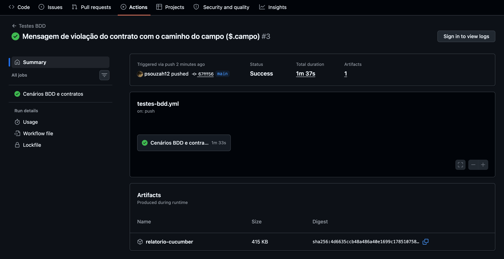
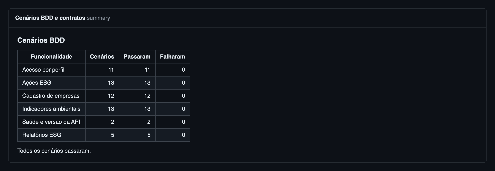
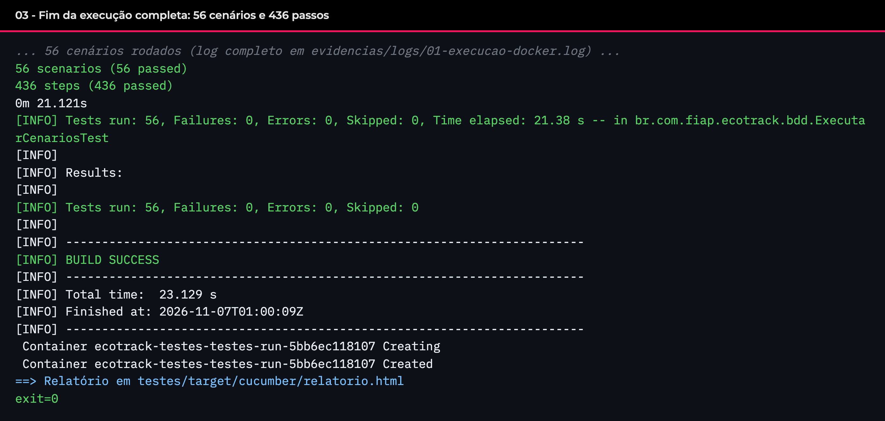
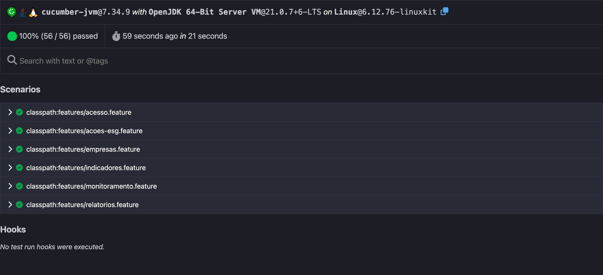
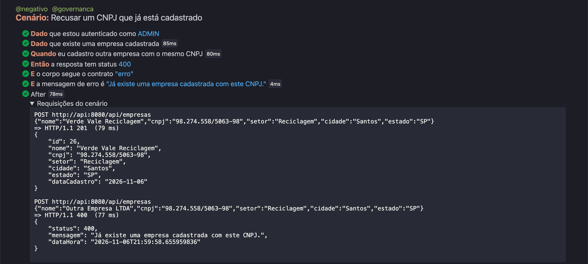
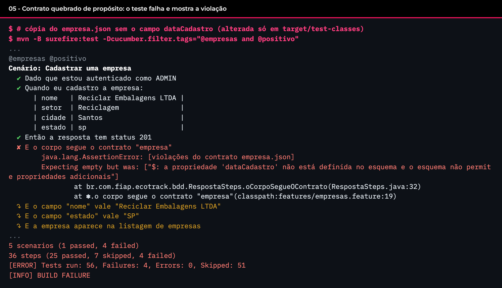

# EcoTrack API - Testes BDD

Paulo Gabriel de Souza, RM 566228

Repositório: https://github.com/psouzah12/ecotrack-testes
API testada: EcoTrack API 1.1.0 ([github.com/psouzah12/ecotrack-devops](https://github.com/psouzah12/ecotrack-devops))
Documentação em PDF: [docs/EcoTrack_Testes_BDD_RM566228.pdf](docs/EcoTrack_Testes_BDD_RM566228.pdf)

## Projeto

O EcoTrack é a API REST em Java 21 e Spring Boot que fiz para registrar dados ambientais de empresas: cadastro de empresas, indicadores de água, energia, resíduos e CO2, ações ESG e relatórios. Nesta entrega escrevi os testes automatizados da API em BDD. Os cenários estão em Gherkin, em português, e rodam com Cucumber e REST Assured contra a API de verdade e o Oracle, os dois subindo pelo Docker Compose.

Resumo do que ficou pronto:

- 6 funcionalidades com 56 cenários: 33 de caminho feliz (`@positivo`) e 23 de falha (`@negativo`)
- as 21 rotas da API testadas, mais `/actuator/health` e `/actuator/info`
- todo cenário confere o status da resposta que está testando e, quando ela tem corpo, valida o contrato em JSON Schema; os cenários de cada funcionalidade também conferem os valores dos campos
- 13 contratos em JSON Schema (draft 2020-12)
- execução por um script que só precisa do Docker, pelo Maven na máquina ou no GitHub Actions ([run #3](https://github.com/psouzah12/ecotrack-testes/actions/runs/42321464083): 56 de 56)
- cada cenário cria os próprios dados pela API e apaga tudo no fim, então os testes não dependem de ordem nem dos dados de exemplo e podem rodar contra um banco vazio

## Estrutura

```
ecotrack-testes/
├── .github/workflows/testes-bdd.yml    pipeline do GitHub Actions
├── docker-compose.yml                  Oracle, API e o container dos testes
├── scripts/
│   ├── executar-testes.sh              sobe tudo, roda os cenários e derruba
│   └── ci/resumo-cucumber.sh           tabela de resultados no resumo do Actions
├── testes/
│   ├── Dockerfile                      imagem que roda os testes (Maven e JDK 21)
│   ├── pom.xml
│   └── src/test/
│       ├── java/br/com/fiap/ecotrack/bdd/
│       │   ├── ExecutarCenariosTest.java   suíte da JUnit Platform que chama o Cucumber
│       │   ├── *Steps.java                 passos em Java de cada funcionalidade
│       │   ├── Cenario.java                estado do cenário e chamadas HTTP
│       │   ├── Contrato.java               validação com JSON Schema
│       │   ├── Dados.java                  corpos das requisições
│       │   └── Hooks.java                  espera a API e apaga o que o cenário criou
│       └── resources/
│           ├── features/                   cenários em Gherkin
│           ├── schemas/                    contratos em JSON Schema
│           └── junit-platform.properties   configuração do Cucumber
├── evidencias/
│   ├── img/                            prints da execução local e do GitHub Actions
│   ├── logs/                           logs completos (logs/github: log do job e resumo do run)
│   └── relatorio-cucumber/             relatório HTML, JSON e XML da execução completa
└── docs/                               documentação em PDF
```

## Como executar

### Só com Docker

Precisa só do Docker com o Compose v2. A API vem da imagem que o pipeline do projeto de DevOps publicou no GHCR, na tag `sha-92e76ea` (a versão 1.1.0 que foi para staging e produção). Uso a tag do commit porque a `1.1.0` é regravada a cada build da main daquele projeto. O banco vem da `gvenzl/oracle-free:23-slim`.

```bash
scripts/executar-testes.sh
```

O script sobe o Oracle e a API, espera os dois ficarem healthy, roda os cenários num container com Maven e JDK 21 e derruba o ambiente no fim, também quando a subida falha ou a execução é interrompida. Na primeira vez leva uns 3 minutos, por causa do download das imagens e do tempo que o Oracle leva para subir. O relatório fica em `testes/target/cucumber/relatorio.html`.

Para rodar só parte dos cenários, os argumentos vão para o Maven:

```bash
scripts/executar-testes.sh -Dcucumber.filter.tags=@negativo
scripts/executar-testes.sh -Dcucumber.filter.tags="@empresas and not @negativo"
```

Com `MANTER_AMBIENTE=1` o script não derruba o Oracle e a API no fim. Os passos do script, um por um:

```bash
docker compose up -d --wait oracle api   # API em http://localhost:8080
docker compose run --rm --build testes   # roda os cenários (o --build pega mudanças nos testes)
docker compose down -v                   # derruba e apaga o banco
```

### Com Maven na máquina

Com JDK 21 e Maven instalados, os testes rodam contra qualquer EcoTrack no ar:

```bash
docker compose up -d --wait oracle api
cd testes
mvn test
```

A configuração vem de variável de ambiente ou de `-D` na linha do Maven:

| Variável | Padrão |
|---|---|
| `ECOTRACK_BASE_URL` | `http://localhost:8080` |
| `ECOTRACK_ADMIN_USER` / `ECOTRACK_ADMIN_PASSWORD` | `admin@ecotrack.com` / `admin123` |
| `ECOTRACK_USER` / `ECOTRACK_USER_PASSWORD` | `user@ecotrack.com` / `user123` |
| `ECOTRACK_IMAGE` (docker compose) | `ghcr.io/psouzah12/ecotrack-api:sha-92e76ea` |

Os padrões são os usuários locais da API. Para testar o staging do projeto de DevOps, por exemplo:

```bash
mvn test -DECOTRACK_BASE_URL=http://localhost:8081 -DECOTRACK_ADMIN_PASSWORD=<senha do staging>
```

Para testar uma imagem da API gerada na máquina, em vez da publicada:

```bash
ECOTRACK_IMAGE=ecotrack-api:local scripts/executar-testes.sh
```

### No GitHub Actions

O workflow está em [.github/workflows/testes-bdd.yml](.github/workflows/testes-bdd.yml). Ele roda em push para `main` (menos quando o push só muda arquivos `.md`, `docs/` ou `evidencias/`), em pull request para `main` e pelo botão "Run workflow", que tem um campo para filtrar por tag.

| Passo | O que faz |
|---|---|
| Configurar JDK 21 | Temurin 21 com cache do Maven |
| Subir Oracle e API | `docker compose up -d --wait oracle api` e mostra o `/actuator/info` |
| Rodar os cenários | `mvn test` contra `http://localhost:8080` |
| Resumo dos cenários | tabela por funcionalidade na aba Summary do run; falha se nenhum cenário rodou |
| Publicar relatório | artefato `relatorio-cucumber` com o HTML, o JSON e o XML do Cucumber |
| Logs da API | só quando algo falha |
| Derrubar o ambiente | `docker compose down -v`, sempre |

Execuções documentadas:

- [run #1](https://github.com/psouzah12/ecotrack-testes/actions/runs/42318857934): primeira versão, 53 de 53
- [run #2](https://github.com/psouzah12/ecotrack-testes/actions/runs/42320965862): ajustes feitos depois de uma revisão, 56 de 56
- [run #3](https://github.com/psouzah12/ecotrack-testes/actions/runs/42321464083): versão entregue, 56 de 56 em 1m37s





A página do run é pública, mas os logs e a aba Summary pedem login no GitHub. O log do job, baixado pela API do GitHub, está em [evidencias/logs/github](evidencias/logs/github).

## Cenários

| Funcionalidade | Arquivo | Cenários | O que verifica |
|---|---|---:|---|
| Cadastro de empresas | `empresas.feature` | 12 | cadastro, consulta, listagem, alteração, exclusão, CNPJ repetido, exclusão bloqueada quando há indicadores, empresa inexistente, id inválido e erro por campo |
| Indicadores ambientais | `indicadores.feature` | 13 | registro de água, energia, resíduos e CO2, consulta, lista por empresa, filtro por tipo, correção, exclusão, valor negativo, empresa inexistente, tipo inválido e indicador inexistente |
| Ações ESG | `acoes-esg.feature` | 13 | planejamento, mudança de status, consulta, lista por empresa, filtro por status, alteração, exclusão, status inválido, campos obrigatórios e ação inexistente |
| Relatórios ESG | `relatorios.feature` | 5 | resumo da empresa, peso de uma ação no impacto, resumo geral conferido com as listagens e os 404 |
| Acesso por perfil | `acesso.feature` | 11 | leitura pública, leitura com USER, escrita sem login, senha errada e escrita com USER |
| Saúde e versão | `monitoramento.feature` | 2 | health da API e do banco, versão e commit em execução |

Exemplo, de `relatorios.feature`:

```gherkin
Contexto:
  Dado que estou autenticado como ADMIN
  E que existe uma empresa cadastrada
  E que a empresa registrou 7800 "kWh" de "ENERGIA"
  E que a empresa registrou 410 "kg" de "RESIDUOS"
  E que a empresa tem uma ação de "EFICIENCIA_ENERGETICA" com status "CONCLUIDA" e impacto de 300
  E que a empresa tem uma ação de "RECICLAGEM" com status "PLANEJADA" e impacto de 700

Cenário: Peso de uma ação no impacto da empresa
  Quando eu consulto o impacto da ação de "EFICIENCIA_ENERGETICA"
  Então a resposta tem status 200
  E o corpo segue o contrato "impacto"
  E o campo "impactoEstimado" vale 300
  E o campo "impactoTotalEmpresa" vale 1000
  E o campo "percentualSobreTotal" vale 30
```

Os números nos cenários seguem o padrão brasileiro (`1320,5`), porque o Cucumber lê `{bigdecimal}` com a vírgula decimal quando o arquivo é `# language: pt`.

Tags usadas:

| Tag | Cenários | Uso |
|---|---:|---|
| `@positivo` / `@negativo` | 33 / 23 | caminho feliz e falha |
| `@governanca` | 16 | permissão, integridade dos dados e rastreabilidade |
| `@inclusao` | 4 | mensagens de erro que dizem qual campo corrigir |
| `@eficiencia` | 4 | tempo de resposta das consultas públicas |
| `@empresas`, `@indicadores`, `@acoes`, `@relatorios`, `@acesso`, `@monitoramento` | | uma por funcionalidade |

## Testes de API e contratos

Todas as rotas passam por pelo menos um cenário que confere o status. Quando a resposta tem corpo, o cenário também confere os campos e o contrato:

| Rota | Status testados | Contratos |
|---|---|---|
| `GET /api/empresas` | 200 | `lista-empresas` |
| `GET /api/empresas/{id}` | 200, 400, 404 | `empresa`, `erro` |
| `POST /api/empresas` | 201, 400, 401, 403 | `empresa`, `erro`, `erros-validacao`, `acesso-negado` |
| `PUT /api/empresas/{id}` | 200 | `empresa` |
| `DELETE /api/empresas/{id}` | 204, 403, 409 | `erro`, `acesso-negado` |
| `GET /api/indicadores` | 200, 400 | `lista-indicadores`, `erro` |
| `GET /api/indicadores/{id}` | 200, 404 | `indicador`, `erro` |
| `GET /api/indicadores/empresa/{id}` | 200 | `lista-indicadores` |
| `POST /api/indicadores` | 201, 400, 404 | `indicador`, `erros-validacao`, `erro` |
| `PUT /api/indicadores/{id}` | 200, 403 | `indicador`, `acesso-negado` |
| `DELETE /api/indicadores/{id}` | 204 | sem corpo |
| `GET /api/acoes-esg` | 200 | `lista-acoes` |
| `GET /api/acoes-esg/{id}` | 200, 404 | `acao`, `erro` |
| `GET /api/acoes-esg/empresa/{id}` | 200 | `lista-acoes` |
| `POST /api/acoes-esg` | 201, 400 | `acao`, `erros-validacao` |
| `PUT /api/acoes-esg/{id}` | 200 | `acao` |
| `PATCH /api/acoes-esg/{id}/status` | 200, 400, 403, 404 | `acao`, `erro`, `acesso-negado` |
| `DELETE /api/acoes-esg/{id}` | 204 | sem corpo |
| `GET /api/relatorios/resumo` | 200 | `resumo` |
| `GET /api/relatorios/empresa/{id}` | 200, 404 | `resumo`, `erro` |
| `GET /api/relatorios/impacto/{id}` | 200, 404 | `impacto`, `erro` |
| `GET /actuator/health` | 200 | `health` |
| `GET /actuator/info` | 200 | `info` |

Os contratos ficam em `testes/src/test/resources/schemas` e são validados com a biblioteca `networknt/json-schema-validator`. Decisões:

- nos contratos dos DTOs da API (empresa, indicador, acao, impacto, resumo, erro e erros-validacao) todos os campos estão em `required` e os objetos têm `additionalProperties: false`: se um campo for removido, renomeado ou aparecer um campo novo, o teste falha
- os campos que podem ser nulos (`observacao`, `impactoEstimado`, `dataFimPrevista`) têm `null` entre os tipos aceitos
- os contratos do Actuator (health e info) e do 403 (acesso-negado) exigem só os campos que os testes usam
- enums com os valores de `TipoIndicador`, `CategoriaAcao` e `StatusAcao`, datas no formato `AAAA-MM-DD`, CNPJ com máscara e UF com duas letras maiúsculas
- o validador roda com a checagem de `format` ligada, então uma data como `2026-13-45` não passa
- tipos repetidos (id, data, quantia, enums) ficam em `comum.json` e os outros arquivos usam `$ref`
- a API tem três formatos de erro, cada um com o seu contrato: o objeto do `GlobalExceptionHandler` (`erro`), a lista de erros de validação (`erros-validacao`) e o 403 com o corpo padrão do Spring Boot (`acesso-negado`); o 401 vem sem corpo

Para conferir que o contrato pega mesmo uma mudança, tirei o `dataCadastro` de uma cópia do `empresa.json` e rodei os 5 cenários positivos de empresa (`@empresas and @positivo`). Os 4 que validam esse contrato falharam; o de exclusão passou, porque só valida o 404 com o contrato `erro` ([evidencias/logs/02-contrato-quebrado.log](evidencias/logs/02-contrato-quebrado.log)):

```
✘ E o corpo segue o contrato "empresa"
    java.lang.AssertionError: [violações do contrato empresa.json]
    Expecting empty but was: ["$: a propriedade 'dataCadastro' não está definida no esquema e o esquema não permite propriedades adicionais"]
```

A mensagem do validador sai no idioma configurado na máquina que roda os testes.

## ESG nos testes

| Pilar | Onde aparece |
|---|---|
| Ambiental | registro e correção de indicadores de energia, água, resíduos e CO2; ações de reciclagem, eficiência energética e compensação de carbono; tempo de resposta das consultas públicas abaixo de 2 s (`@eficiencia`), ligado ao exemplo de eficiência e uso de recursos computacionais do enunciado |
| Social | mensagens de erro em português que apontam o campo e o motivo (`@inclusao`); leitura pública dos dados e dois perfis de uso, ADMIN e USER |
| Governança | só o ADMIN altera dados (401 e 403); CNPJ único; empresa com indicadores não pode ser apagada (409); o resumo geral bate com as listagens; health e info mostram versão e commit em execução; contratos que travam mudanças não combinadas na API |

## Evidências

Execução local completa, do ambiente zerado até o relatório (logs em [evidencias/logs](evidencias/logs)):





Anexo de um cenário no relatório, com as requisições e respostas reais:



Contrato quebrado de propósito:



O relatório HTML completo está em [evidencias/relatorio-cucumber/relatorio.html](evidencias/relatorio-cucumber/relatorio.html), e os outros prints em [evidencias/img](evidencias/img).

## O que os testes mostraram

Escrevendo os cenários, encontrei três comportamentos da API que não transformei em teste com falha, mas que pedem uma regra nova na próxima versão. As chamadas que comprovam cada um estão em [evidencias/logs/05-comportamentos-api.log](evidencias/logs/05-comportamentos-api.log).

1. A API aceita uma ação com `dataFimPrevista` anterior à `dataInicio`.
2. O status de uma ação pode voltar de `CONCLUIDA` para `PLANEJADA`, sem nenhum registro da mudança.
3. O 403 e o 401 não seguem o formato de erro da API: o 403 vem com o corpo padrão do Spring Boot e o 401 vem sem corpo. A correção é configurar no `SecurityConfig` um `accessDeniedHandler` e um `authenticationEntryPoint` que escrevam o mesmo `ErroResponse`.

## Tecnologias

| Parte | Tecnologias |
|---|---|
| BDD | Cucumber 7.34 (Gherkin em português), JUnit Platform Suite 1.14 e PicoContainer |
| Chamadas HTTP | REST Assured 5.5 |
| Contratos | JSON Schema 2020-12 com networknt json-schema-validator 1.5 |
| Asserções | AssertJ 3.27 |
| Build | Maven 3.9 e JDK 21 |
| Ambiente | Docker Compose v2, Oracle Free 23 e a imagem da EcoTrack API publicada no GHCR |
| CI | GitHub Actions |

## Checklist de entrega

| Item | OK |
|---|:---:|
| No mínimo 3 cenários BDD em Gherkin, com casos positivos e negativos | X |
| Testes de todas as APIs: status code, corpo JSON e contrato com JSON Schema | X |
| Execução simples e documentada, local e em pipeline de CI | X |
| Código-fonte em .ZIP com Dockerfile, scripts e README | X |
| Documentação com os cenários, prints das configurações e evidências (PDF) | X |
